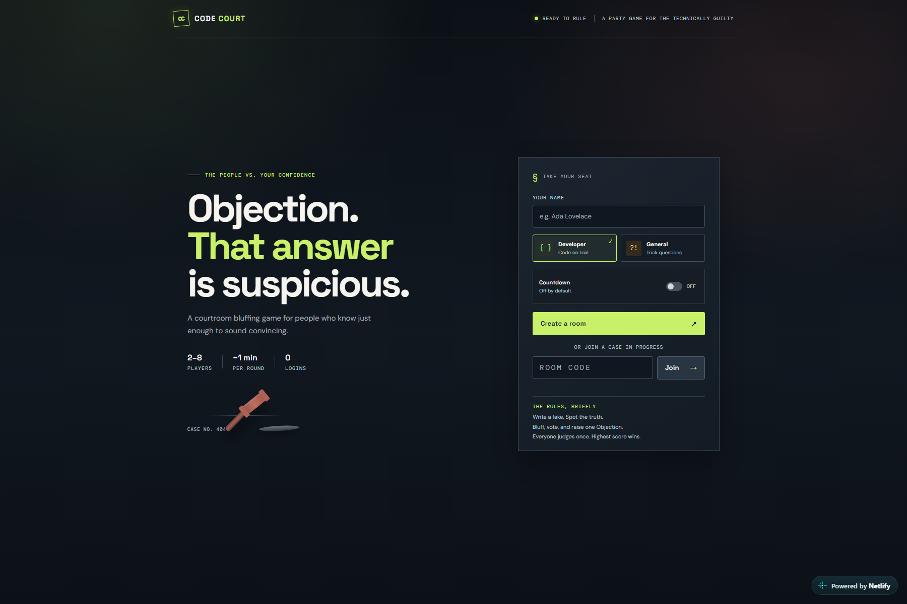

# Code Court

**A courtroom bluffing game for 2–8 players, built for dev-team warm-ups.**
By Sitarama Kumar Mokkapati

▶ **Play it:** https://ephemeral-chaja-db04bb.netlify.app



## How it plays
1. One player creates a room and shares the code; everyone joins from their own phone or laptop. No login.
2. Each round shows a short code snippet (Developer mode) or a plain-English trick question (General mode).
3. Players secretly write a **believable fake answer**; a rotating **Judge** sees the truth and predicts which wrong answer will fool the most players.
4. Fakes are shuffled with the truth and two house decoys; everyone votes. Each player has one **Objection** per game to call out a fake.
5. The reveal shows the truth with a one-line explanation, who wrote each fake, who was fooled, and **why each wrong answer is wrong**.

**Scoring:** +3 for picking the truth · +1 per player fooled by your fake · +1 fastest correct vote · Judge +2 for a correct prediction · Objection +2 if right, −1 if wrong. Everyone judges once; highest score wins.

**Extras:** host-controlled pace (no timers) or configurable countdowns · private "Need an idea?" suggestions · reconnect restores your seat · Leave / End game / host hand-over · Play again with the same players.

## Repository layout
| Path | Contents |
|---|---|
| [game-build/](game-build/) | The game: frontend (`public/`), shared game logic (`lib/game-core.js`), questions (`questions.js`), Netlify Function (`netlify/functions/game.ts`), tests |
| [game-design-record.md](game-design-record.md) | Design decisions, approved rules, test scripts, bug log |
| [TRACKER.md](TRACKER.md) | Step-by-step build log with results and evidence |
| [action-points.md](action-points.md) | The plan |
| [submission/](submission/) | Cover image and submission text |

## How it was built
Built with ChatGPT (Work mode) for the Handshake AI Skills Studio × OpenAI Multiplayer Game Challenge, using a plan → build → test → debug loop:
- **Rules reviewed before any code:** caught a 2-player bug (with one faker, the only voteable option was the truth) and fixed it with house decoys.
- **Multi-window play-tests** found and fixed 6 issues: missing "(you)" marker, timers too fast, no way to leave a room, tie-break text shown without a tie, a confusing post-game button, awkward wording.
- **All 15 Developer snippets were executed** to verify their answers; 30 questions validated (decoys and suggestions never equal the truth).
- Deployed on Netlify (Functions + Blobs).

## Run locally
```
cd game-build
npm install
npm test       # builds and plays a full 3-round game against an in-memory store
```
